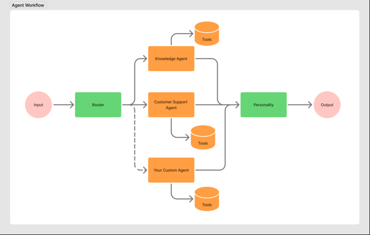

# Getnet Multi-Agent Support System

A stateless HTTP service where cooperating agents answer merchant questions about Getnet products, their own settlements and card machines, and general facts. It refuses unsafe requests and hands off to a person when it cannot ground an answer.

## Build, Configure and Run

**Requires** Docker and a Gemini API key. Google Search grounding needs a paid-tier key.

```bash
cp .env.example .env        # then set GEMINI_API_KEY
docker compose up --build --wait
```

The first start crawls about 70 pages at one request every 2 seconds and then embeds them, so it takes a few minutes. `--wait` returns when `/health` reports ready. Later starts reuse the `app_data` volume and are ready in seconds.

Without compose:

```bash
docker build -t getnet-multi-agent .
docker run --env-file .env -p 8000:8000 -v getnet_data:/app/data getnet-multi-agent
```

Try it:

```bash
curl -s localhost:8000/chat -H 'content-type: application/json' \
  -d '{"message": "How many installments can I split a sale into with the crediário?", "user_id": "cliente1988"}'
```

### API

`POST /chat` takes `{"message": string, "user_id": string}`. `user_id` is any non-empty string. The response is:

| Field | Meaning |
|-------|---------|
| `answer` | Final text, ending with the sources it used |
| `route` | Steps run, from `support`, `knowledge:rag`, `knowledge:web`, `escalation`, `refusal` |
| `sources` | `url`, `title` and `origin` (`brazil_site`, `global_site` or `web`) |
| `ticket_id` | Present only when a ticket was recorded |
| `trace` | Language, per-agent model, latency, tokens and cost, retrieved chunks, request total |
| `request_id` | Id that also appears in every log line of the request |

Validation errors return HTTP 422 as JSON. `GET /health` returns 200 `ready` once the knowledge base exists, and 503 `not_ready` before that.

Simulated merchants are `cliente1988`, `cliente2000` and `cliente_injection`. Any other id gets a not-found answer to support questions.

### Configuration

Everything is set in `.env`; `.env.example` lists every variable.

| Variables | Purpose |
|-----------|---------|
| `GEMINI_MODEL`, `GEMINI_ROUTER_MODEL`, `GEMINI_PERSONALITY_MODEL`, `GEMINI_EMBEDDING_MODEL` | Model per task |
| `GEMINI_MODEL_THINKING`, `GEMINI_ROUTER_THINKING`, `GEMINI_PERSONALITY_THINKING` | Thinking level per task |
| `PRICE_*` | Price table for cost calculation, including Google Search |
| `MAX_MESSAGE_CHARS`, `RAG_TOP_K`, `MAX_TOOL_ITERATIONS`, `REQUEST_TOKEN_BUDGET` | Cost limits |
| `RAG_MAX_PAGES`, `RAG_MIN_SIMILARITY` | Crawl cap and retrieval threshold |
| `EVAL_*` | Evaluation repetitions and gate thresholds |

### Refreshing the knowledge base

Stop the service first, because the vector store allows a single process:

```bash
docker compose stop app
docker compose run --rm app python -m getnet_multi_agent.rag.ingest --refresh
docker compose up -d --wait
```

The current knowledge base stays in place until the new one is fully built.

## Orchestration Architecture



| Component | Responsibility | Tools | Model and thinking |
|-----------|----------------|-------|--------------------|
| Guardrails | Length limit, card and CPF masking, injection heuristics | None | No LLM |
| Router | Ordered steps and the user's language | None | `GEMINI_ROUTER_MODEL`, minimal |
| Knowledge Agent | Answers from Getnet's sites or the web | Retriever, Google Search | `GEMINI_MODEL`, low |
| Customer Support Agent | Answers from the merchant's data | `get_receivables`, `get_terminal_status` | `GEMINI_MODEL`, low |
| Human Escalation Agent (custom agent) | Records a ticket and returns its id | `create_ticket` | No LLM |
| Personality | Applies the brand voice in the user's language | None | `GEMINI_PERSONALITY_MODEL`, minimal |

Agents communicate through direct function calls. `orchestrator.py` runs the Router's steps in order and passes each agent's output to the next.

```text
src/getnet_multi_agent/
├── main.py  orchestrator.py  guardrails.py  llm.py  schemas.py  config.py
├── prompts/   one module per agent
├── agents/    router, knowledge, support, escalation, personality
├── tools/     merchant data, tickets
├── rag/       crawler, extract, chunker, glossary, store, retriever, ingest
└── fixtures/  simulated merchant data
```

## Design Choices

- **Plain Python, no agent framework.** The control flow is a short loop that can be read and tested directly.
- **A model for each task.** Routing and rewriting are simple, so they use the lighter model with minimal thinking. Answering reasons over context and tool results, so it uses the stronger model with low thinking. Thinking tokens are billed as output, so cost is controlled by thinking level, not by shrinking `max_output_tokens`.
- **One LLM wrapper.** `llm.py` is the only caller of the SDK, so tokens, cost, budget, timeout, retry and logs apply to every call. Google Search requests are counted from grounding metadata because they are not in `usage_metadata`.
- **Identity belongs to code.** Support tools declare no parameters, so the LLM cannot pick a `user_id`. Code passes the one from the request.
- **Citations belong to code.** The Knowledge Agent returns chunk numbers, and code maps them to URLs, so it cannot invent a source. Sources and the "not confirmed for Brazil" note are appended after Personality.
- **Personality is checked.** Output with a number missing from the draft, or without the ticket id, is rejected in favor of the draft.
- **Failures are defined outcomes.** Tool failure, LLM failure and exceeded budget stop the sequence and create a ticket, keeping earlier answers. Missing grounding after an earlier answer keeps that answer, with no ticket.
- **Escalation uses no LLM,** so it still works when the LLM or the budget does not.

## Message Workflow

1. **Input.** `POST /chat` validates the payload and assigns a `request_id`.
2. **Guardrails.** Over-length messages and injection attempts get a deterministic refusal, with no LLM call and no Personality. Card numbers and CPF are masked before anything else sees the text.
3. **Router.** Returns validated steps and the language. Unsafe, sensitive or non-informational messages get a `refusal` step.
4. **Agents.** Each step runs in order, for example `support` then `knowledge:rag` for "My card machine won't connect to the internet, what should I do?".
5. **Personality.** Merges the drafts into one answer. If it fails, the draft is returned.
6. **Output.** Code attaches sources and returns the route, trace and `request_id`.

## RAG Pipeline

### Ingestion

- **Sources:** `site.getnet.com.br` and `www.getnet.net/en`, one level deep from each start page, same host, and `/en` paths only for the global site. Required pages are fetched first, so `RAG_MAX_PAGES` cannot exclude them.
- **Crawler:** Sequential, with 2 seconds between requests. Raw HTML is cached in `data/crawl_cache/` and refetched only by the refresh command. A host stops at its first 403 or 429, and the other host continues. Pages are deduplicated by final URL and content hash, keeping only HTTP 200 `text/html`.
- **Extraction:** Removes script, style, nav, header and footer, plus text repeated in 30% or more of a host's pages. Main-content detection is avoided because it drops tables, product cards and FAQ entries.
- **Chunking:** By heading and by FAQ question, so each question stays with its own answer.

### Storage

Chroma persists chunks and embeddings from `GEMINI_EMBEDDING_MODEL` in the Docker volume, in cosine space. A new build is stored aside and swapped in only when complete. Ingestion runs on startup when the collection is empty, and a failed source does not stop the service.

### Retrieval

Users write in English while the main source is in Portuguese, so a glossary links terms such as `Get Clássica = Get Classic`, `Link de Pagamento = Payment Link` and `antecipação = receivables advance`. Matched terms expand the embedded query, up to half of top-k goes to chunks that match the glossary lexically, and vector hits fill the rest. A chunk qualifies if its similarity (1 minus cosine distance) reaches `RAG_MIN_SIMILARITY`, or if it matches the glossary. No qualifying chunk means no LLM call and a handoff.

### Generation

The Knowledge Agent receives chunks inside delimiters marked as untrusted data, and returns validated JSON with `grounded`, `answer` and `citations`. If it reports no grounding, the system does not guess. Answers use the user's language and name their sources, and content from the global site is flagged as not confirmed for Brazil.

## How LLM Tools Are Used

- **Function calling (Support).** `get_receivables` returns settlement dates and amounts, and `get_terminal_status` returns connectivity, last errors and suggested actions. The first turn must call a tool, and `MAX_TOOL_ITERATIONS` bounds the loop. The complete model content, including thought signatures, goes back on the next turn.
- **Google Search grounding (Knowledge, source `web`).** Used for general factual questions such as weather and exchange rates. It always runs in its own call, never together with function calling.
- **`create_ticket` (Escalation).** Called by code, and appends to `data/tickets/tickets.jsonl` in the volume.
- **Tool results are untrusted.** They arrive in an `untrusted_data` field and are never treated as instructions. Tools return structured results and handle their own failures.

## Testing Strategy

```bash
uv sync
uv run pytest
```

- **Traceability.** Every requirement `R1` to `R62` in `specs/001-multi-agent-support/spec.md` appears in a test name, and `test_R_ids_covered` fails otherwise.
- **Unit tests** mock the LLM and cover the wrapper, guardrails, crawler, extraction, chunking, cosine store and retrieval.
- **Integration tests of the orchestration** call the HTTP endpoint and run the full orchestration with the LLM stubbed at the wrapper. They assert route, data flow between agents, `user_id` injection, refusals and handoff, including LLM failure, tool failure and exceeded budget.
- **Container checks.** The ten official scenarios run against the built container, since tests that read a Dockerfile do not prove the image works.

## Evaluation and Observability

### Evaluation

```bash
uv run python evals/run.py            # against http://localhost:8000
uv run python evals/run.py --only official --repeats 1
```

`evals/dataset.jsonl` holds the ten official scenarios, a compound message and adversarial cases: prompt injection in both languages, injection inside a tool result, a card number in the message, another merchant's data, and out-of-scope and unsafe requests. Each has an expected route and assertions. RAG scenarios check the expected fact in the retrieved context and in the answer separately, so a failure points to retrieval or generation.

`evals/report.md` shows routing accuracy, citation rate, correct refusal rate, assertion pass rate, p50 and p95 latency, average cost per request and total run cost. The script exits non-zero below the `EVAL_MIN_*` thresholds, so it works as a regression gate. LLM output varies, so each case runs 3 times by default.

### Observability today

Logs are JSON on stdout. Each LLM call logs `request_id`, agent, model, latency, tokens, search requests and cost. Each request logs route, language, refusal or escalation reason, ticket id and totals. Card numbers and CPF are masked first. Every response also carries its own `trace`.

### Production plan

These dashboards and alerts are a proposal and are not implemented. Logs would ship to a collector such as Grafana Loki or Cloud Logging, which can derive the metrics.

**Dashboards**

| Dashboard | Panels |
|-----------|--------|
| Traffic and routing | Requests per route, language, refusal reasons |
| Quality | Escalation rate by reason, no-grounding rate, Personality rejections, daily eval scores |
| Cost | Cost per request and per day, tokens by model and agent, search requests |
| Reliability | p50 and p95 latency per agent, LLM errors and retries, budget exceeded, knowledge base readiness |

**Alerts**

| Condition | Why |
|-----------|-----|
| `/health` not ready for 5 minutes | Knowledge answers are all handing off |
| `llm_failure` tickets above 5% of requests for 10 minutes | Provider or key problem |
| `no_grounding` tickets above twice the weekly baseline | Content or retrieval drift |
| Cost per request above twice the baseline | Prompt or routing regression |
| p95 latency above 30 seconds for 15 minutes | Degraded experience |
| Any card or CPF pattern detected in shipped logs | Masking failure, treated as an incident |
| Scheduled `evals/run.py` exits non-zero | Quality regression |

## Known Limits

- `user_id` is trusted without authentication. A production deployment needs an authenticated identity in front of this API.
- There is no conversation memory: each request stands alone, and follow-up questions lose context.
- Google Search grounding requires a paid-tier key. Without one, web questions become handoffs.
- Web source URLs are Google redirect links, titled with the site's domain, because that is what grounding metadata returns.
- `site.getnet.com.br` has answered 403 on some pages, which stops that host's crawl by design. Pages fetched before the block are kept, and required pages are fetched first.
- Merchant data and tickets are simulated and local. Tickets go to a JSONL file, not a real support system.
- Refresh requires stopping the service. A partial knowledge base counts as ready.
- Embedding tokens are estimated, because the embedding response has no usage data.
- Sites are read as static HTML, so content rendered only by JavaScript is not ingested.
